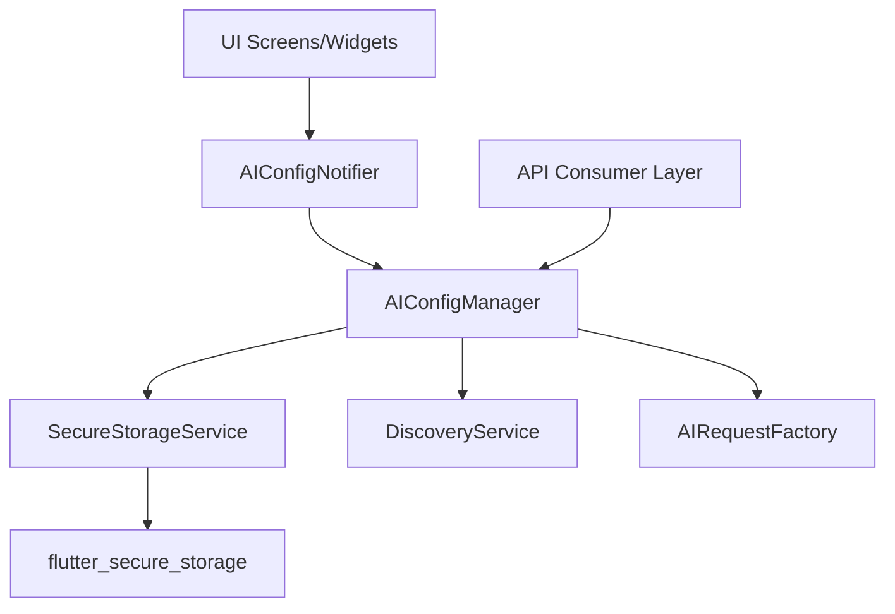

# Architecture: AI Key and Model Management Module

## Overview

The module follows a clean architecture approach, designed as a standalone Flutter package. It uses **ChangeNotifier** for state management to maintain zero dependencies on external state libraries like BloC, ensuring maximum compatibility.

## Component Diagram

## Key Components

### 1. AIConfigManager (Core Business Logic)
- Orchestrates key rotation and automatic cool-down.
- Manages selected providers and models.
- Interacts with `DiscoveryService` for dynamic model fetching.
- Persists state using `SecureStorageService`.

### 2. AIConfigNotifier (State Management)
- Wraps the `AIConfigManager` to provide a Flutter-friendly `ChangeNotifier`.
- Handles UI-specific logic like search filtering and success/error messaging.
- Notifies listeners when the configuration changes.

### 3. AIRequestFactory (Abstraction Layer)
- Generates precise request details (URL, Headers, Body) for different providers.
- Supports OpenAI, Google AI, and Anthropic formats.
- Decoupled from the HTTP client, allowing users to use `http`, `dio`, or any other library.

### 4. SecureStorageService (Persistence)
- Encapsulates `flutter_secure_storage` for sensitive API keys.
- Handles cross-platform security (Android Keystore, Windows DPAPI).

## Data Flow

### Key Exhaustion & Cool-down
1. The consumer reports an error via `manager.reportKeyExhausted()`.
2. The Manager marks the current key as exhausted with a timestamp.
3. The Manager rotates to the next available key in the pool.
4. If the consumer requests credentials later, the Manager checks if enough time has passed (default 8h) to reactivate the exhausted keys automatically.

## Platform Considerations

- **Android**: Uses encrypted SharedPreferences.
- **Windows**: Uses DPAPI for secure storage.
- **Pure Dart Core**: All rotation and request generation logic is pure Dart.
