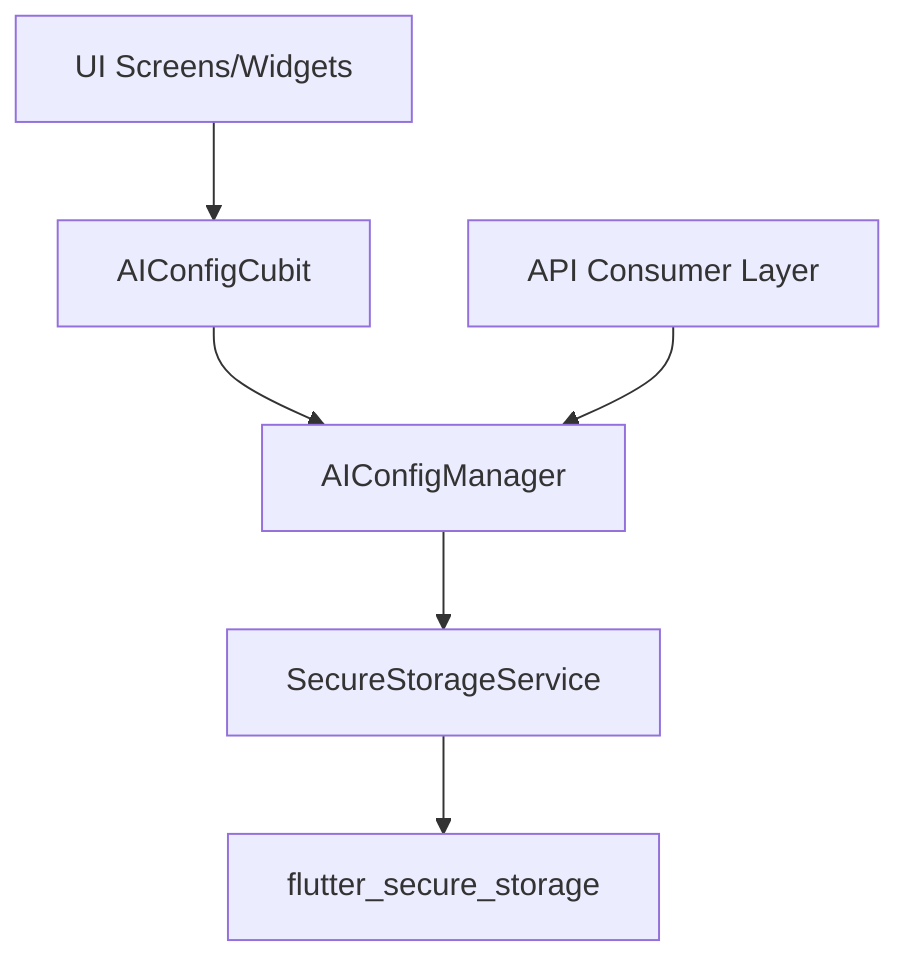

# Architecture: AI Key and Model Management Module

## Overview

The module follows a clean architecture approach adapted for Flutter, using **Cubit** for state management and **GetIt** for service injection. It is designed to be self-contained and reusable.

## Component Diagram

## Key Components

### 1. AIConfigCubit (State Management)
- Manages the UI state, including the list of providers, selected model, and the status of the API key pools.
- Emits states such as `AIConfigLoading`, `AIConfigReady`, and `AIConfigNoKeysAvailable`.
- Reacts to user interactions (selecting a provider, adding a key).

### 2. AIConfigManager (Business Logic)
- Registered as a Singleton via **GetIt**.
- Orchestrates the logic for key rotation (`reportKeyExhausted`).
- Provides the currently active credentials to the rest of the application.
- Interfaces with the persistence layer to load and save configurations.

### 3. SecureStorageService (Persistence)
- Encapsulates `flutter_secure_storage`.
- Handles sensitive data (API keys) with platform-specific security (Android Keystore, Windows DPAPI).
- Manages the serialization/deserialization of the key pools.

## Data Flow

### Initialization
1. `GetIt` registers `AIConfigManager` and `SecureStorageService`.
2. `AIConfigManager.init()` is called on app startup.
3. Saved keys and selected models are loaded from `flutter_secure_storage`.
4. `AIConfigCubit` initializes with the loaded data.

### Key Exhaustion Flow
1. The **API Consumer Layer** (e.g., a Chat Service) makes a request and receives a "Rate Limit" or "Quota Exceeded" error.
2. The Consumer calls `AIConfigManager.reportKeyExhausted()`.
3. `AIConfigManager` updates the pool:
    - Marks the current key as exhausted.
    - Moves the pointer to the next available key.
    - If no keys remain, notifies `AIConfigCubit`.
4. `AIConfigCubit` emits a state that triggers a UI warning/dialog.

## Platform Considerations

- **Android**: Uses standard encrypted SharedPreferences via `flutter_secure_storage`.
- **Windows**: `flutter_secure_storage` uses DPAPI. Requires minimal setup in `main.dart` to ensure the storage is initialized correctly.
- **Dart Pure Logic**: All business logic (rotation, model filtering) is written in pure Dart to ensure 100% compatibility across platforms.
